# product-to-paper

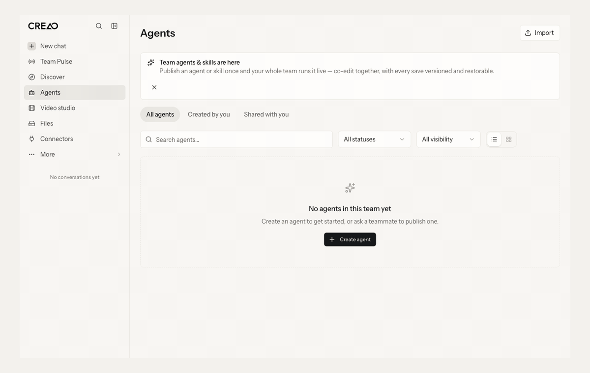

One agent skill and one CLI to take a live web product into [Paper](https://paper.design), and design new features in that product's own style. The skill runs in three stages:

1. **Pull** brings real pages and components into Paper as **editable layers**, not screenshots.
2. **System** turns them into a design system: tokens, components with their states, layout patterns, a state matrix. Every layer is bound to the product's tokens.
3. **Design** creates a new feature from that system with Claude Opus, gates it with a person, builds it with Codex, then walks the build as a user and reviews it before a second gate.

It was built and tested on [Creao](https://agent.creao.ai) (an AI agent OS). The full worked example, with numbers, is in [`examples/creao`](examples/creao).

## Install

```bash
npx github:danielosagie/product-to-paper
```

That's it. It puts the `product-to-paper` skill in `~/.agents/skills` and symlinks it into `~/.claude/skills` (and `~/.codex/skills` if you use Codex), so rerunning the command updates every agent at once. The same package runs the CLI: `npx -y github:danielosagie/product-to-paper pull --help`. Add `install --project` to install into the current project instead.

**The Creao run in Paper:** [open the file](https://app.paper.design/file/01M4P9ZN0ZXPM1SGSHNFM33MJ1)

## Tour

### 1. Pull: live pages as editable layers

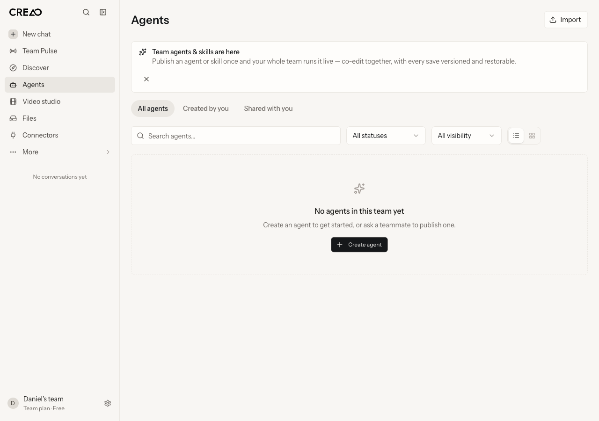

Creao `/apps` at 1280, imported by `paper-pull`. Every layer is editable and bound to Creao's tokens. 0.36% of pixels differ from live, all text anti-aliasing.

### 2. System: tokens and components

<p>
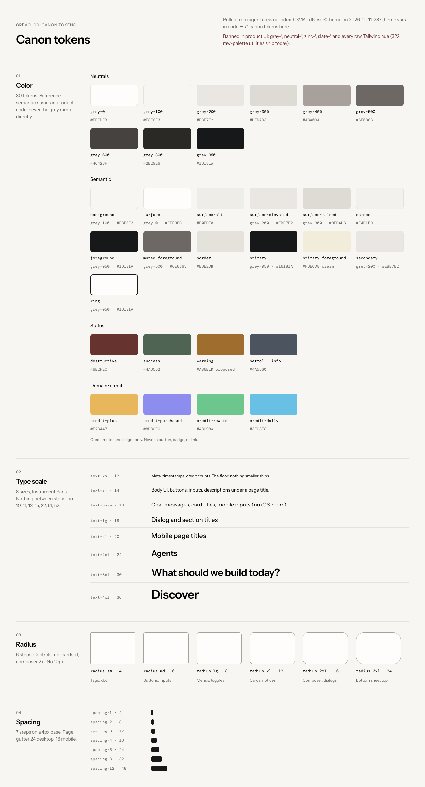
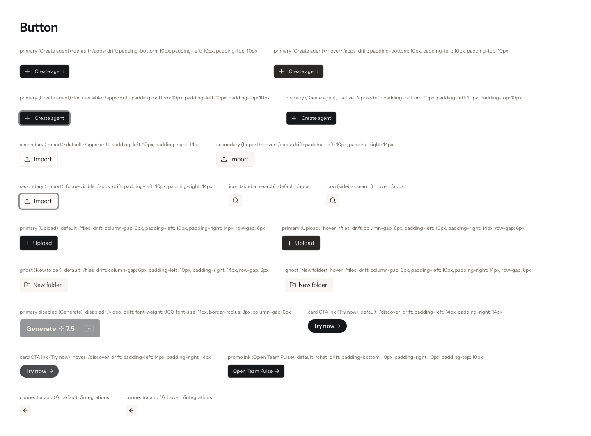
</p>

287 theme variables became 71 canon tokens. 52 of 64 component states came straight from the live app.

### 3. Patterns and states

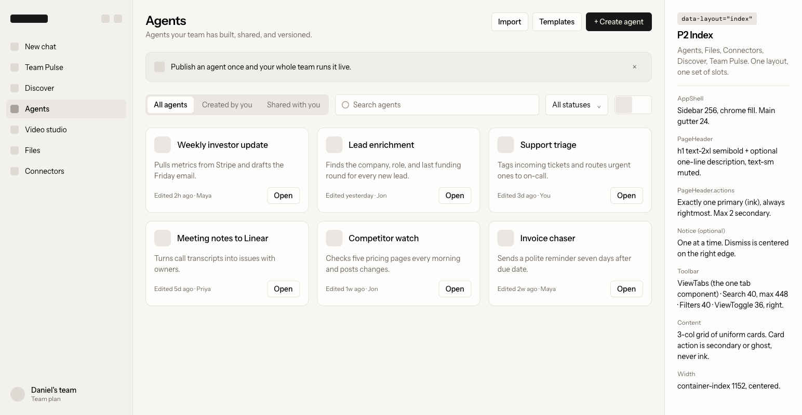
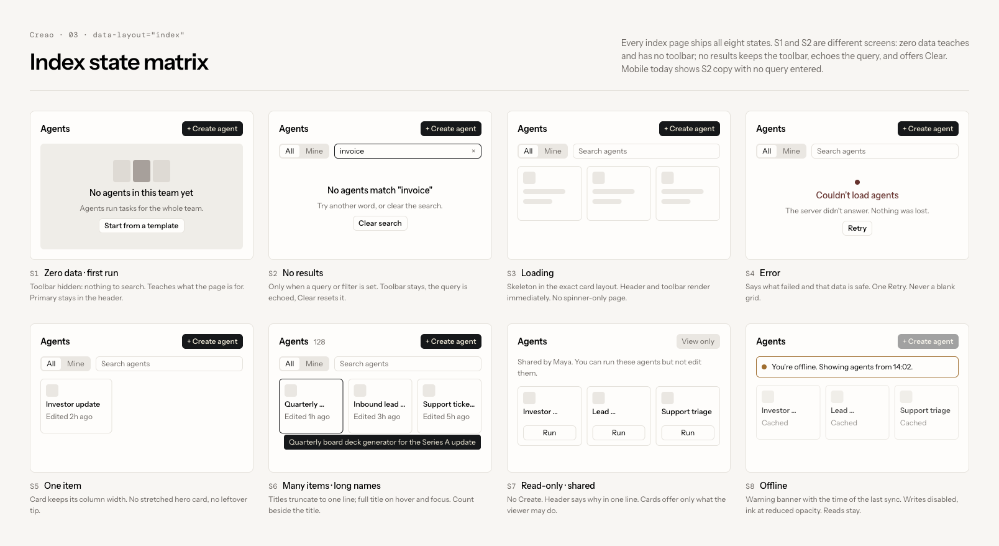

One layout per screen type, cloned from the pulls. The state matrix covers zero data, no results, loading, error, read-only and offline.

### 4. Storyboard and ideas

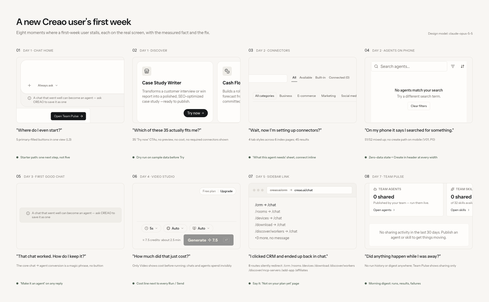

<p>
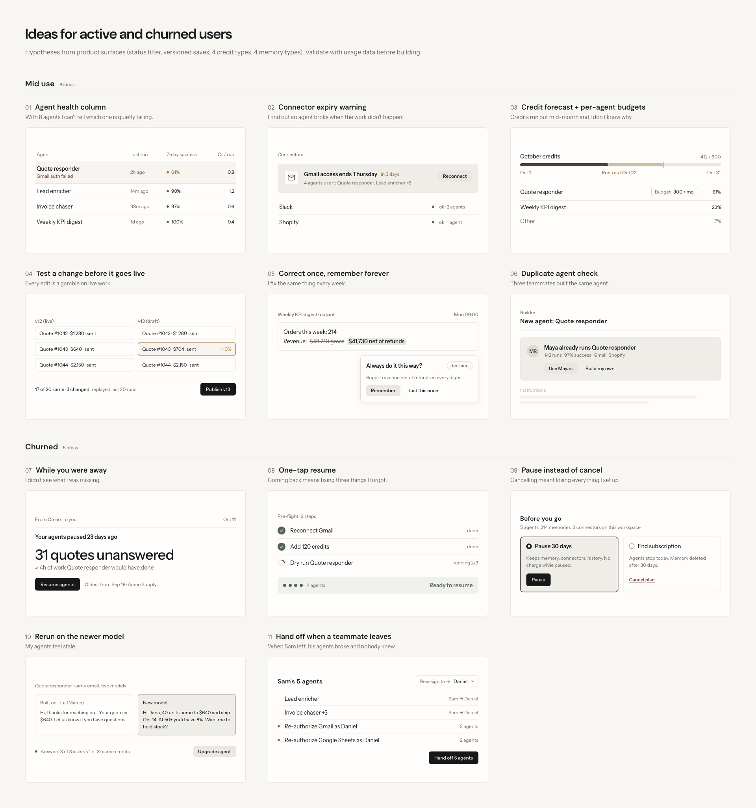
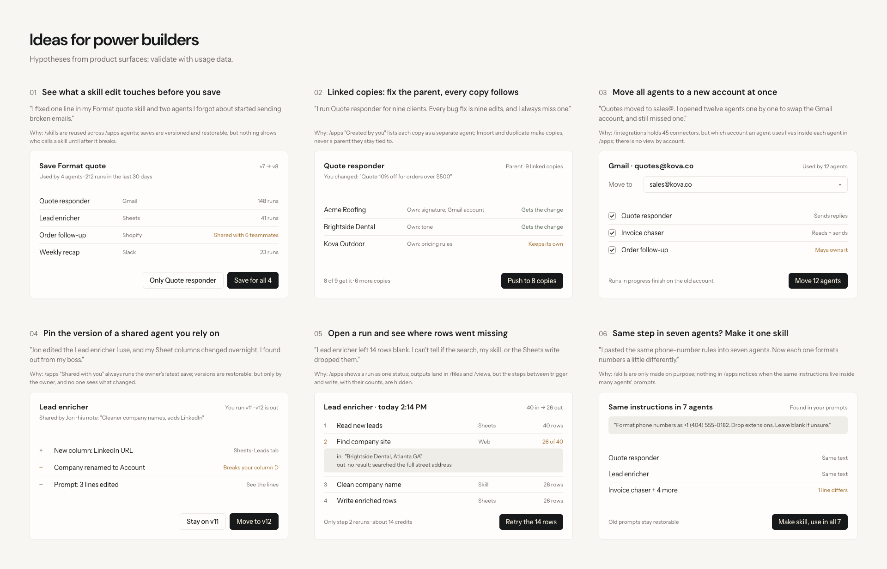
</p>

29 feature ideas, each with a thumbnail in Creao's style, for the gaps in a user's first week, mid use and after churn.

### 5. Design: While you were away + one-tap resume

<p>
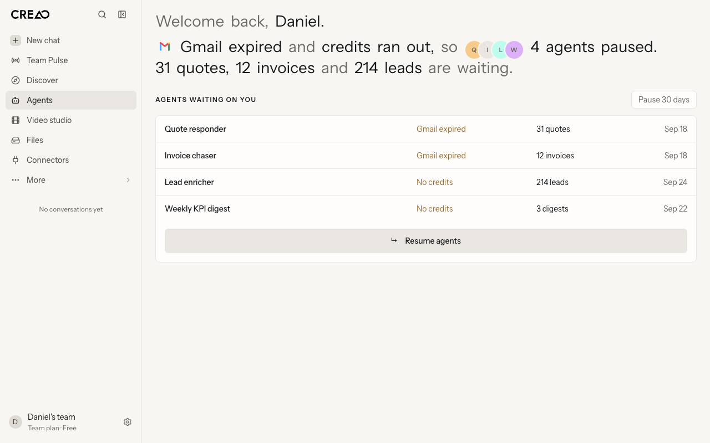
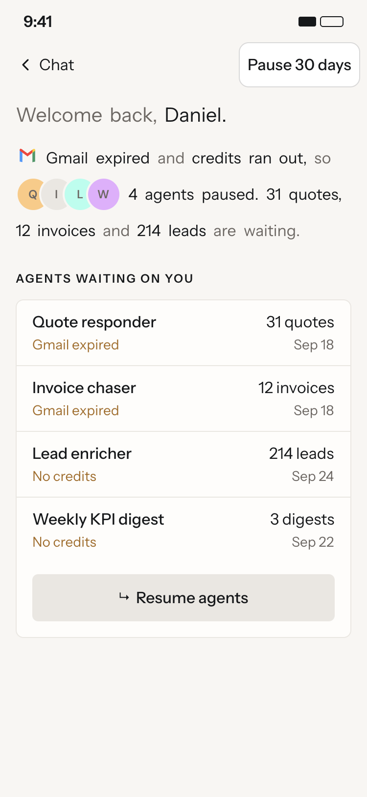
</p>
<p>
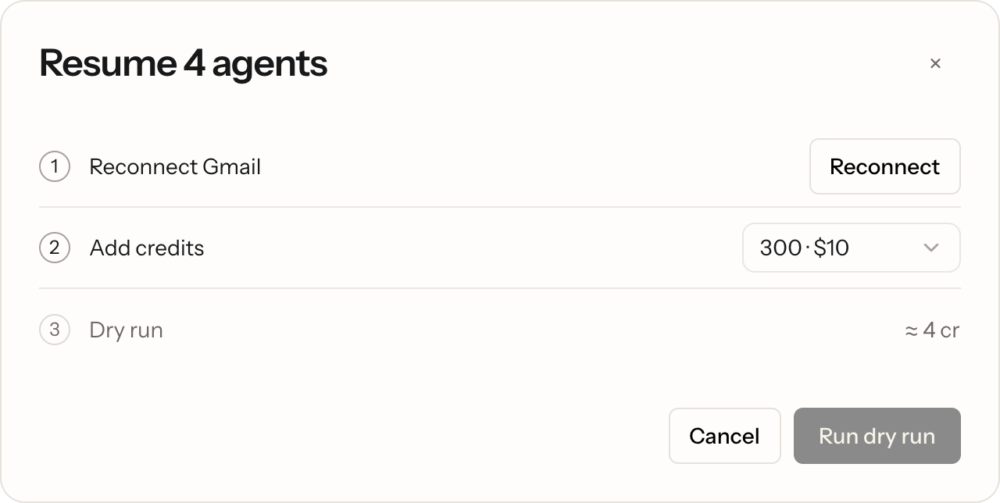
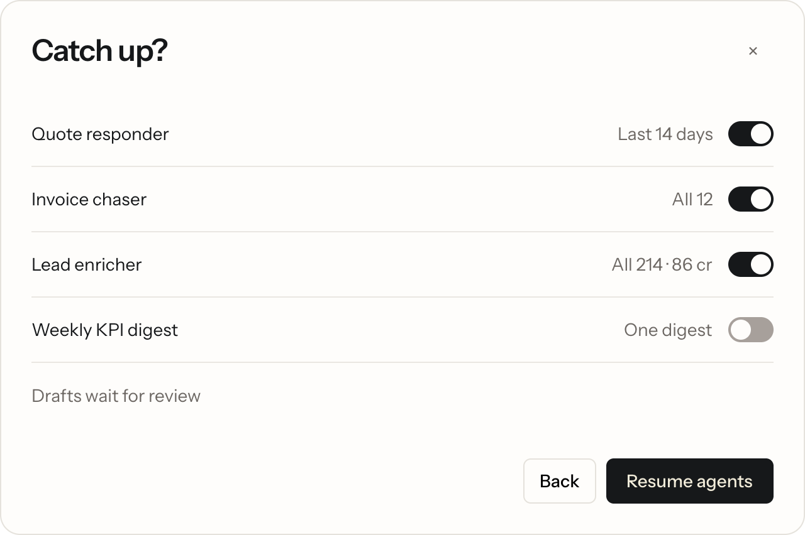
</p>
<p>
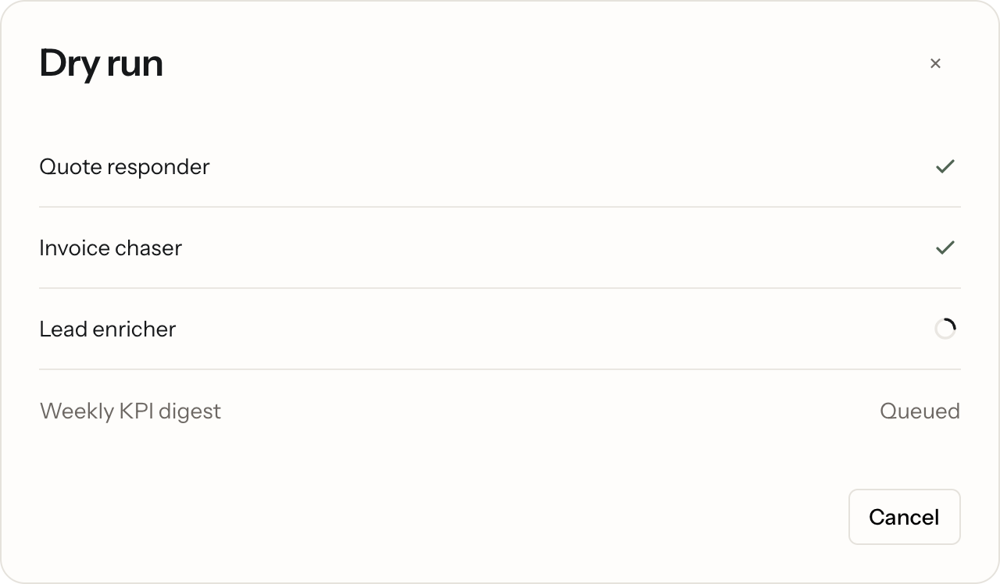
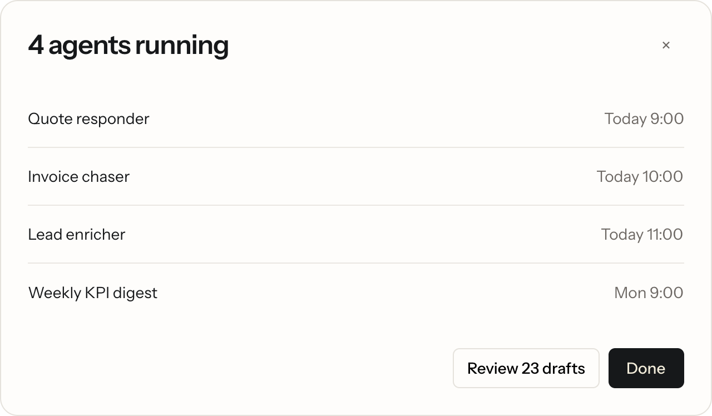
</p>

Designed by Claude Opus 5.5 from the System page: Creao's sidebar, type and tokens, with the entry points (email, banner, push) and every state at 1280 and 375.

## What it can do

| Capability | Creao receipt |
|---|---|
| Find every route from the JS bundle | 35 paths: 21 render, 8 redirect |
| Import pages as editable, token-bound layers | 12 pages, 5,875 nodes, 0.36% of pixels off |
| Import components in each state | 52 of 64 (default, hover, focus-visible, active, disabled) |
| Report drift, the values that match no token | Matched the DOM probe exactly on `/apps` |
| Design a feature in the product's style, with two human gates | 16 artboards for one feature, desktop and mobile |
| Audit a product against its own system | 18 violations, each with the check that catches it |

## Why

- **Screenshots are dead pixels.** You can't inspect them, rebind them or build on them.
- **Agents drift when they draw from scratch.** You get the wrong font, invented spacing, extra tags and too many words.
- **This pins every layer to what ships.**
  - Imported values are rebound to the product's tokens, so anything left literal in Paper *is* drift.
  - New screens are assembled from cloned live components.

## Setup

You need all of this once per machine.

| What | How | Why |
|---|---|---|
| **Paper desktop** | Install from paper.design and open your file. | The canvas, with an MCP server at `http://127.0.0.1:29979/mcp`. |
| **Paper MCP in your agent** | Claude Code: install the `paper-desktop` plugin, or add the MCP server URL above. | Agents read and write the canvas. |
| **Paper file id** | Copy it from the file URL `app.paper.design/file/<id>/…`, then `export PAPER_FILE_ID=<id>`. | `paper-pull` writes to this file and refuses to touch another. |
| **A Chromium browser signed in to your product, with remote debugging on** | Chrome, Helium, Arc, Brave or Edge. Chrome: open `chrome://inspect/#remote-debugging` and allow it, or start it with `--remote-debugging-port=9222`. browser-use attaches the same way, so a session set up for browser-use already works. | `paper-pull` attaches over plain CDP, in background tabs, using your signed-in session. No browser extension is needed to drive it. |
| **Paper Snapshot extension, installed** | Chrome Web Store, "Paper Snapshot" (id `lidfahaahiogmnlccifabccgplofocck`). Any local Chromium profile works. | `paper-pull` reads its serializer from disk and runs it over CDP. It only needs to be installed, not active. |
| **Node 20+** | The install command above. `paper-pull` runs through `npx`, nothing to link. | The one CLI: runs the Paper import over pages and elements, token-bound. |
| Optional: **Codex CLI** | `codex exec -m gpt-6.1-sol …` | The builder in the Design stage. |
| Optional: **Mobbin MCP** | Add the Mobbin server, then sign in from your agent (`/mcp` in Claude Code). | Inspiration in the Design stage. |
| Optional: **iOS Simulator + serve-sim** | Xcode, then `npx serve-sim`. | The mobile walk in real WebKit. |

**Keep 5 GB of disk free.** On a 16 GB Mac, swap reached 17.9 of 19.5 GB and the disk briefly hit zero mid-run. `paper-pull` refuses to start below 5 GB free.

## Use

There is one CLI, because importing is the only repetitive part. Everything else is judgment, and the skills tell the agent how to do it through Paper's MCP.

```bash
alias paper-pull="npx -y github:danielosagie/product-to-paper pull"
paper-pull --scan --base https://app.example.com --bundle https://app.example.com/assets/index-XXXX.js   # which routes render
paper-pull --base https://app.example.com --routes routes.txt --widths 1280,375 --max 10              # import pages
paper-pull --base https://app.example.com --spec elements.json --page "00 System"                     # import components and states
```

Every import:
- runs in a fresh background tab,
- is bound to your Paper tokens on the way in (colors, sizes, radius, spacing, fonts),
- prints its drift: the values that didn't match any token.

| Stage | Produces |
|---|---|
| Pull | Page "Live screens": every route × 1280 and 375, editable and token-bound |
| System | Page "00 System": tokens, components × states, layout patterns, state matrix |
| Design | A prototype page per feature, Gate A, Codex build, walk on desktop and iOS, Gate B |

## Design rules the skill enforces

These came from review of the Creao run and are written into every design brief:

- **Their layout, their type.**
  - Clone the product's real sidebar, headers, rows and components.
  - Every text layer uses a font token (`var(--font-sans)`), never a font name.
  - Sizes and weights are copied from the matching live element.
- **Word budget.**
  - Title: at most 4 words.
  - One supporting line: at most 8 words.
  - Rows: a name plus a 2 to 4 word fact.
  - Dialogs: about 20 to 25 words.
- **Nothing decorative.**
  - No subtitles, tags, pills, chips, status or active dots, step labels, captions under buttons, or labels on artboards.
  - Status is wording plus text color.
- **One primary action per view.** A disabled primary is the ink fill at 50% opacity.
- **Creative inside the system.** New components are welcome when they are built from the product's own tokens and primitives.

## Measured limits

| Measure | Value |
|---|---|
| Pull fidelity (Creao `/apps`, 1280) | 0.36% of pixels off, all glyph anti-aliasing, no layout shift |
| Paper write speed | 1,050 nodes in 1.1 s; 6,290 nodes / 8.4 MB in 4.0 s |
| Tallest pages pulled whole | 5,277 px (Discover), 5,090 px (mobile Connectors) |
| Background-tab throttling | a hidden tab that serializes many elements stalls; `paper-pull` uses one fresh tab per import |
| Search ceiling | Paper `find_nodes` returns at most 200 matches; search by literal value and loop |
| Real ceiling | memory and disk, not Paper. Pull in batches of 10 pages. |

## Layout

```
skills/product-to-paper/SKILL.md   the skill
bin/                the npx installer (and `pull`, which runs paper-pull)
cli/                paper-pull, the one CLI
examples/creao/     the worked example: guideline, audit, element spec, routes, story file, probe
docs/               the demo GIF and board images
```

## License

MIT
